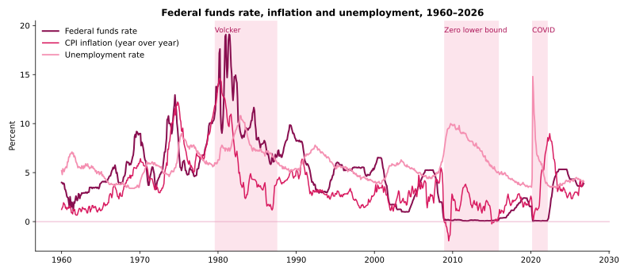
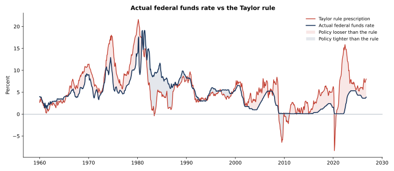
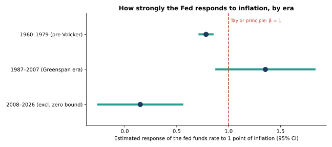
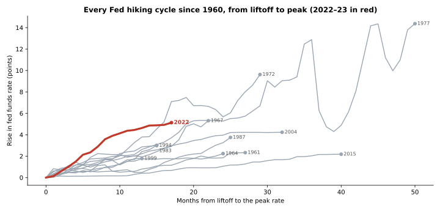

# How Does the Federal Reserve Set Interest Rates? Evidence from 1960–2026

**A time-series analysis of the federal funds rate, inflation and unemployment over 66 years: testing the Taylor rule, estimating how the Fed's response to inflation has changed across eras, and putting the 2022–23 hiking cycle in historical context.**

`Python` · `pandas` · `matplotlib` · `statsmodels` · time series · OLS with Newey-West (HAC) errors · Taylor rule · macroeconomics



---

## Questions

1. How have the federal funds rate, inflation and unemployment moved together since 1960?
2. Does the Taylor rule describe what the Fed actually did, and when did policy deviate from it most?
3. Has the Fed followed the **Taylor principle**, raising rates by more than one-for-one with inflation, and has that changed across eras?
4. How did the 2022–23 tightening compare with past hiking cycles?

## Data

Monthly data, July 1954 to October 2026 (analysis uses 1960 onward, 801 months, no missing values), pulled directly from official sources:

| Series | Source |
|---|---|
| Effective federal funds rate (daily, averaged to monthly) | Federal Reserve Board, [H.15](https://www.federalreserve.gov/releases/h15/) |
| CPI-U, all items, seasonally adjusted (`CUSR0000SA0`) | U.S. Bureau of Labor Statistics |
| Unemployment rate, seasonally adjusted (`LNS14000000`) | U.S. Bureau of Labor Statistics |

The merged dataset is in [`data/us_macro_monthly.csv`](data/us_macro_monthly.csv).

## Method

1. **Data preparation.** Merged the three series, averaged daily rates to monthly, and computed year-over-year CPI inflation and the real interest rate.
2. **Taylor rule.** Built the Taylor (1993) prescription, *i = 2 + π + 0.5(π − 2) + 0.5 × output gap*, with the output gap proxied by the unemployment gap through Okun's law. Compared it with actual policy by Fed chair.
3. **Estimated policy rules.** Regressed the funds rate on inflation and the unemployment gap separately for 1960–79, 1987–2007 and 2008–2026 (excluding zero-lower-bound months), using Newey-West standard errors (12 lags) to handle autocorrelation.
4. **Hiking cycles.** Identified every tightening cycle with a rise of at least 1.5 points, from liftoff to peak, and compared speed, size and starting inflation.

## Key findings

**1. Real rates tell the inflation story.** In the 1970s the average real rate was about **0%** and inflation kept rising. In the 1980s it averaged **+4.4%** and inflation came down. Real rates have been negative on average since 2010.

**2. The Taylor rule fits the Greenspan era best and recent years worst.**



| Period | Avg gap, actual minus rule (pts) | Avg absolute gap (pts) |
|---|---:|---:|
| 1960–1979 | −1.84 | 2.27 |
| Volcker 1979–1987 | +3.03 | 5.11 |
| **Greenspan 1987–2006** | **−0.30** | **1.19** |
| Bernanke 2006–2014 | −0.49 | 1.96 |
| Yellen 2014–2018 | −2.40 | 2.41 |
| Powell 2018–2026 | −4.09 | 4.52 |

The loosest years against the rule were **2022 (−12.7 points)** and **2021 (−7.6)**, when inflation hit 7% to 9% while rates stayed near zero.

**3. The Fed broke the Taylor principle before 1979.**



- **1960–1979:** each 1-point rise in inflation raised the funds rate by only **0.78** points (95% CI 0.71 to 0.86), so real rates *fell* as inflation rose.
- **1987–2007:** the response rose to **1.35**, consistent with the Taylor principle (95% CI 0.87 to 1.84).
- **2008–2026:** a simple same-month rule no longer fits (R² = 0.17), largely because of the zero lower bound and the delayed response to the 2021 inflation surge.
- The response to unemployment was stable in every era: about **−0.8 to −0.9** points of funds rate per point of unemployment above 5%.

**4. 2022–23 was historically fast, and historically late.**



Of 12 hiking cycles since 1960, the 2022–23 cycle (+5.13 points in 17 months, about **3.6 points per year**) was the second fastest, behind only 1972–74 and ahead of the Volcker-era hikes. It also started with the **highest inflation of any cycle (8.6%)**. By the peak rate in August 2023, inflation had fallen to 3.7% while unemployment stayed between 3.4% and 3.7%.

## Limitations

- The Taylor rule uses a constant natural unemployment rate (5%) and CPI rather than the Fed's preferred PCE measure.
- The estimated rules ignore policy lags, interest-rate smoothing and inflation expectations.
- During the zero-lower-bound years, the Fed relied on tools (quantitative easing, forward guidance) that the funds rate does not capture.

**Next steps:** a forward-looking rule with a lagged funds rate, real-time data vintages, and time-varying estimates of the natural rate of unemployment.

## Repository structure

```
├── fed_rates_analysis.ipynb      # full analysis with code, outputs and written interpretation
├── data/
│   └── us_macro_monthly.csv      # fed funds, CPI and unemployment, monthly, 1954–2026
└── images/                       # charts used in this README
```

## How to run

```bash
pip install pandas numpy matplotlib statsmodels jupyter
jupyter notebook fed_rates_analysis.ipynb
```

Run all cells from the repository folder.

---

**Author:** María Sofía Montoya-Chang · M.S. in Data Analytics · [LinkedIn](https://www.linkedin.com/in/maria-montoya-chang)

**References:** Taylor, J. B. (1993). Discretion versus policy rules in practice. *Carnegie-Rochester Conference Series on Public Policy*, 39, 195–214. · Clarida, R., Galí, J., & Gertler, M. (2000). Monetary policy rules and macroeconomic stability: evidence and some theory. *Quarterly Journal of Economics*, 115(1), 147–180.
